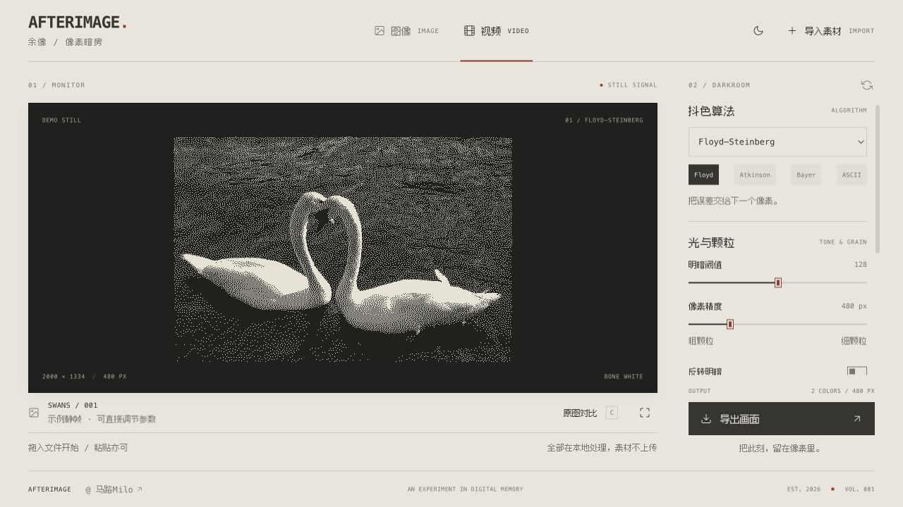

# AFTERIMAGE / 余像

一个极简的图像与视频抖色暗房。暖骨白、炭黑、暗红，搭配像素中文字与等宽排版。

[打开在线版](https://kanshao2077.github.io/afterimage-studio/)



## 本地运行

需要 Node.js 22.12+（或 Vite 8 支持的较新版本）。

```sh
npm install
npm run dev
```

打开终端显示的本地地址。默认进入视频模式，先显示可调节的示例静帧；导入文件后切换为实际素材。

```sh
npm run build
npm run preview
```

生产文件输出到 `dist/`，可使用任意静态托管服务。没有账号、后端服务或外部模型调用，媒体仅在浏览器中处理。

## GitHub Pages

推送到 `main` 后，GitHub Actions 自动运行测试、构建并发布网站。工作流从 Pages 配置读取站点路径，图片、字体和首页链接均支持仓库子路径。

本地检查 Pages 构建：

```sh
VITE_BASE_PATH=/afterimage-studio/ npm run build
SITE_URL=https://kanshao2077.github.io/afterimage-studio/ node scripts/prepare-pages.mjs
npm run preview
```

首次使用其他仓库部署时，在 Settings → Pages 中选择 GitHub Actions。没有服务器或密钥需要配置。

## 使用

- 导入、拖入或粘贴本地图像和视频，支持多个素材切换和移除。
- 30 种算法，包含 Floyd–Steinberg、Atkinson、Bayer、ASCII 以及自定义扩散核。
- 调节阈值、工作分辨率、调色板、明暗反转及色调；高级参数可以展开。
- 用分割滑块对照原始画面，或全屏查看；`C` 切换对比，`G` 切换网格，空格播放或暂停视频。
- 保存浏览器本地预设，复制常用参数链接。
- 导出 PNG、JPEG、WebP、SVG 图像或当前视频帧；录制 WebM、MP4、GIF。

视频按实际播放时间录制，静音输出。MP4 是否可用取决于浏览器和系统编码器，不支持时回退到 WebM。GIF 最长边为 480 像素、最高 20 FPS。JPEG 有损，SVG 使用像素矢量图形，较细颗粒可能产生较大文件。图像导出保留原图尺寸，并保留所选工作分辨率形成的颗粒。

## 代码与验证

- `src/SignalStudio.tsx`：界面、素材管理及导出交互。
- `src/studio.css`：复古未来主义主题及响应式布局。
- `src/hooks/useDithering.ts`、`useVideoDithering.ts`：图像和视频处理。
- `src/hooks/useVideoRecording.ts`、`src/utils/gifEncoder.ts`：视频录制与 GIF。
- `src/utils/algorithms/`：原项目算法实现。
- `validation/`、`design-qa.md`：本地浏览器验证记录与样本，不提交到仓库，也不包含在生产构建中。

```sh
npm run test:run -- src/test/utils/algorithms src/test/utils/export.test.ts src/test/utils/palettes.test.ts
```

## 来源与许可

此版本基于 [Oslonline/dithering-studio](https://github.com/Oslonline/dithering-studio)，上游快照为 `9298a44c54a8d02a5b5b5956c1c1c7f9785fda59`，遵循 Apache 2.0。保留原始 `LICENSE` 和 `NOTICE`，并随静态构建提供副本。AFTERIMAGE 的界面与改动由马路Milo制作，详见 `CHANGES.md`。

中文像素字体使用 Fusion Pixel，与《INFINITE TV》一致；字体许可位于 `public/fonts/LICENSE-OFL.txt`。
